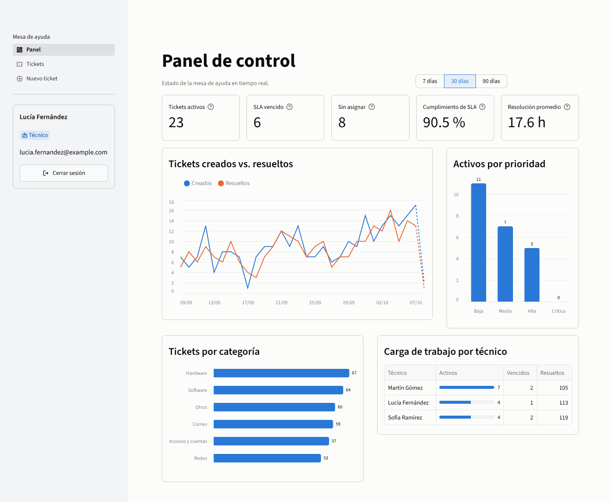
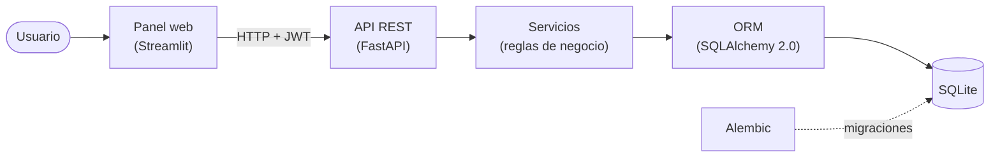
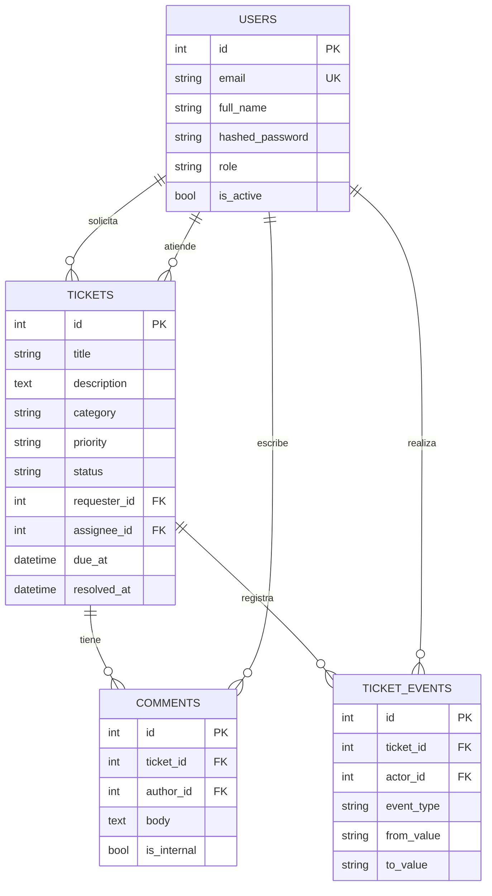
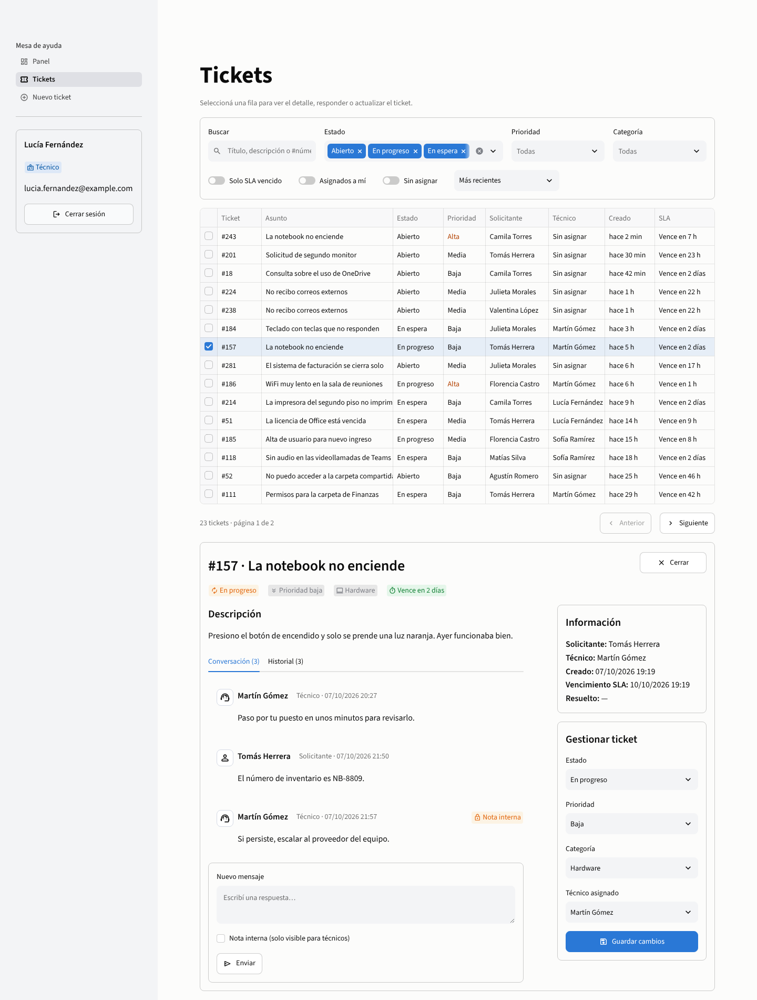
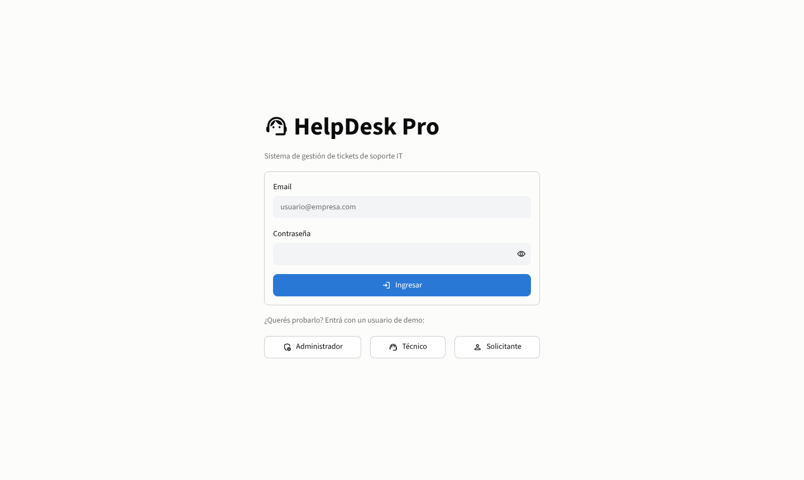
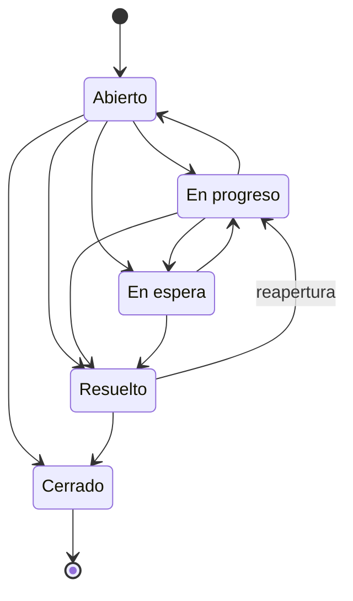

# HelpDesk Pro

[](https://github.com/JuanMBF/python/actions/workflows/ci.yml)


**Sistema de gestión de tickets para una mesa de ayuda de soporte IT**, desarrollado íntegramente en Python.
Incluye una API REST con autenticación JWT, base de datos relacional con migraciones, reglas de negocio
(SLA, flujo de estados, permisos por rol) y un panel web con métricas en tiempo real.



---

## Funcionalidades

- **Tickets** con categoría (hardware, software, redes, accesos, correo) y prioridad.
- **SLA automático**: cada ticket recibe un vencimiento según su prioridad y el sistema detecta los vencidos.
- **Flujo de estados validado** (abierto → en progreso → en espera → resuelto → cerrado), con reapertura.
- **Historial de auditoría**: cada cambio de estado, prioridad, categoría o técnico queda registrado.
- **Conversación por ticket** entre el solicitante y soporte, con **notas internas** solo visibles para técnicos.
- **Roles y permisos**: solicitante, técnico y administrador. Cada solicitante ve únicamente sus tickets.
- **Panel de métricas**: tickets activos, vencidos, sin asignar, % de cumplimiento de SLA,
  tiempo medio de resolución, tendencia diaria y carga de trabajo por técnico.
- **Búsqueda, filtros, ordenamiento y paginación** en el listado de tickets.
- **Administración de usuarios**: alta, cambio de rol, desactivación y blanqueo de contraseña.
- **Datos de demo realistas** (360 tickets, 12 usuarios) para probarlo en segundos.

## Tecnologías

| Capa | Tecnología |
|------|-----------|
| API REST | **FastAPI** + Uvicorn, documentación OpenAPI/Swagger automática |
| Base de datos | **SQLAlchemy 2.0** (ORM tipado) + **SQLite**, migraciones con **Alembic** |
| Validación | **Pydantic v2** y pydantic-settings (configuración por variables de entorno) |
| Seguridad | **JWT** (PyJWT), contraseñas con **bcrypt**, control de acceso por rol |
| Panel web | **Streamlit** + Altair (gráficos) + pandas |
| Calidad | **pytest** (60 tests, ~98 % de cobertura), **Ruff** (lint + formato), **GitHub Actions** |
| Despliegue | **Docker** + Docker Compose |

## Arquitectura



El panel **no accede a la base de datos**: consume la API igual que lo haría cualquier otro cliente
(una app móvil, otro sistema, etc.). La lógica de negocio vive en una capa de servicios independiente
de FastAPI, por lo que se puede testear y reutilizar sin pasar por HTTP.

```
.
├── app/                      # Backend (API REST)
│   ├── api/                  # Endpoints, dependencias (auth, roles) y router
│   ├── core/                 # Configuración, seguridad (JWT, bcrypt) y excepciones de dominio
│   ├── db/                   # Engine, sesión y tipos de columna propios
│   ├── domain/               # Reglas puras: enums, SLA y flujo de estados
│   ├── models/               # Modelos ORM: User, Ticket, Comment, TicketEvent
│   ├── schemas/              # Esquemas Pydantic de entrada y salida
│   ├── services/             # Casos de uso: tickets, usuarios y métricas
│   ├── main.py               # Aplicación FastAPI
│   └── seed.py               # Migraciones + datos de demo
├── dashboard/                # Panel web (Streamlit)
│   ├── app.py                # Login, navegación por rol
│   ├── api_client.py         # Cliente HTTP de la API
│   └── views/                # Panel, tickets, nuevo ticket, usuarios
├── migrations/               # Migraciones de base de datos (Alembic)
├── tests/                    # Tests de API, dominio, base de datos y migraciones
├── Dockerfile
└── docker-compose.yml
```

### Modelo de datos



## Cómo ejecutarlo

### Opción 1: local (Python 3.11 o superior)

```bash
git clone https://github.com/JuanMBF/python.git helpdesk-pro
cd helpdesk-pro

python -m venv .venv
source .venv/bin/activate          # En Windows: .venv\Scripts\activate
pip install -r requirements.txt

python -m app.seed                 # crea la base de datos y carga los datos de demo
uvicorn app.main:app --reload      # API en http://localhost:8000
```

En otra terminal (con el entorno virtual activado):

```bash
streamlit run dashboard/app.py     # Panel en http://localhost:8501
```

### Opción 2: Docker

```bash
docker compose up --build
```

- Panel web: <http://localhost:8501>
- API y documentación interactiva (Swagger): <http://localhost:8000/docs>

### Usuarios de demo

En la pantalla de login hay botones para entrar directamente con cada rol.

| Rol | Email | Contraseña |
|-----|-------|------------|
| Administrador | `admin@example.com` | `Admin1234!` |
| Técnico | `lucia.fernandez@example.com` | `Demo1234!` |
| Solicitante | `valentina.lopez@example.com` | `Demo1234!` |

Para regenerar los datos desde cero: `python -m app.seed --reset`.

## Capturas

**Listado y detalle de un ticket** (vista de técnico): filtros, conversación con notas internas e historial.



**Login** con acceso rápido a los usuarios de demo.



## API REST

Todos los endpoints (salvo login y health) requieren un token JWT en el header `Authorization: Bearer <token>`.
La documentación completa e interactiva está en `/docs`.

| Método | Endpoint | Descripción | Acceso |
|--------|----------|-------------|--------|
| `POST` | `/api/v1/auth/login` | Inicia sesión y devuelve un token JWT | Público |
| `GET` | `/api/v1/auth/me` | Usuario autenticado | Todos |
| `GET` | `/api/v1/tickets` | Lista con filtros (`status`, `priority`, `category`, `assignee_id`, `overdue`, `q`), orden y paginación | Todos* |
| `POST` | `/api/v1/tickets` | Crea un ticket | Todos |
| `GET` | `/api/v1/tickets/{id}` | Detalle con conversación e historial | Todos* |
| `PATCH` | `/api/v1/tickets/{id}` | Cambia estado, prioridad, categoría o técnico | Técnicos |
| `POST` | `/api/v1/tickets/{id}/comments` | Agrega un comentario o nota interna | Todos* |
| `GET` | `/api/v1/stats/overview` | Métricas del panel | Técnicos |
| `GET` | `/api/v1/users` | Lista usuarios (filtrable por rol) | Técnicos |
| `POST` | `/api/v1/users` | Crea un usuario | Admin |
| `PATCH` | `/api/v1/users/{id}` | Cambia rol, estado o contraseña | Admin |
| `GET` | `/health` | Estado del servicio y de la base de datos | Público |

\* Los solicitantes solo pueden ver y comentar **sus propios** tickets.

Ejemplo con `curl`:

```bash
TOKEN=$(curl -s -X POST localhost:8000/api/v1/auth/login \
  -d 'username=lucia.fernandez@example.com&password=Demo1234!' \
  | python -c "import sys, json; print(json.load(sys.stdin)['access_token'])")

curl -s "localhost:8000/api/v1/tickets?status=open&priority=high&sort=due_at" -H "Authorization: Bearer $TOKEN"
```

## Reglas de negocio

**SLA por prioridad**: el vencimiento se calcula al crear el ticket y se recalcula si cambia la prioridad.

| Prioridad | Tiempo máximo de resolución |
|-----------|-----------------------------|
| Crítica | 4 horas |
| Alta | 8 horas |
| Media | 24 horas |
| Baja | 72 horas |

**Flujo de estados**: las transiciones no permitidas devuelven `409 Conflict`.



Otras reglas:

- "En espera" significa que se espera una respuesta del solicitante: **cuando responde, el ticket vuelve
  automáticamente a "En progreso"**.
- Los tickets cerrados no se pueden modificar ni comentar.
- Solo se pueden asignar tickets a técnicos o administradores activos.
- Un administrador no puede desactivarse ni quitarse el rol a sí mismo, para evitar dejar el sistema sin administradores.

## Tests y calidad de código

```bash
pip install -r requirements-dev.txt

pytest --cov             # 60 tests: API, permisos, reglas de negocio, métricas y base de datos
ruff check .             # linter
ruff format --check .    # formato
alembic check            # verifica que las migraciones coincidan con los modelos
```

El pipeline de **GitHub Actions** ejecuta todo lo anterior en Python 3.11, 3.12 y 3.13 en cada push.

## Decisiones técnicas

- **Capa de servicios desacoplada de FastAPI**: los servicios lanzan excepciones de dominio
  (`NotFoundError`, `ConflictError`, etc.) que la API traduce a códigos HTTP. Así la lógica se puede
  testear y reutilizar sin pasar por HTTP.
- **Reglas de negocio puras** (`app/domain`): el SLA y el flujo de estados no dependen de la base de datos,
  así que se testean con tests unitarios simples.
- **Privacidad**: si un solicitante pide un ticket ajeno, la API responde `404` y no `403`, para no
  revelar que ese ticket existe.
- **Fechas siempre en UTC con zona horaria**: un tipo de columna propio (`UTCDateTime`) evita mezclar
  fechas con y sin zona horaria, un error común con SQLite.
- **Base de datos portable**: los enums se guardan como texto y las métricas se calculan sin funciones
  de fecha específicas de un motor. El proyecto está probado con SQLite.
- **Migraciones verificadas por tests**: un test aplica las migraciones sobre una base vacía y comprueba
  que el esquema resultante sea idéntico al definido por los modelos.
- **Auditoría**: cada cambio queda en `ticket_events` con autor, valor anterior y valor nuevo.

## Autor

**Juan Barros**: estudiante de la Tecnicatura en Desarrollo de Software (UADE), con experiencia en soporte
técnico y mesa de ayuda.

- GitHub: [@JuanMBF](https://github.com/JuanMBF)
- Más proyectos: [Portfolio](https://github.com/JuanMBF/Portfolio) (HelpDesk Pro en Java + React, Mongo
  Replica Lab e IT Support Toolkit) y [ProyectoDB](https://github.com/JuanMBF/ProyectoDB) (scraper de
  precios de supermercados con MySQL y MongoDB).

Proyecto bajo licencia [MIT](LICENSE).
